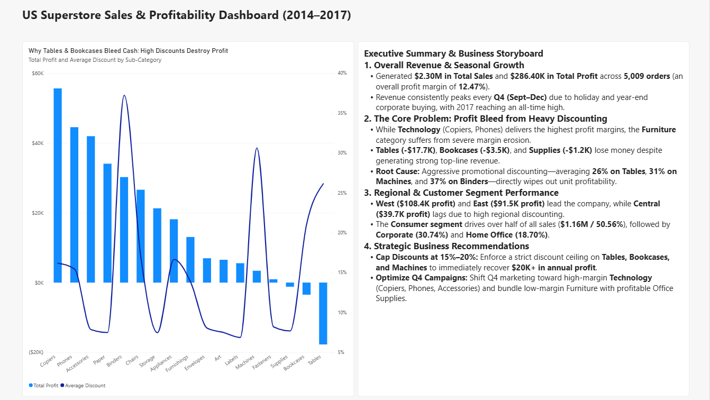

# Task 2: Data Visualization and Storytelling – US Superstore Sales Analysis

## 1. Project Overview
This project was completed for **Task 2 of the Elevate Labs Data Analyst Internship**. Using **Microsoft Power BI Desktop**, I transformed raw retail transaction records from the **US Sample Superstore** dataset into an interactive, two-page executive dashboard and business storyboard that uncovers key revenue trends, regional performance, and root causes of profit margin erosion.

## 2. Repository Structure
- `data/Sample - Superstore.csv` – Raw US Superstore retail dataset (9,994 records, 21 columns)
- `analysis/Superstore_Sales_Visual_Report.pdf` – Exported 2-page PDF visual report
- `dashboard/Superstore_Sales_Analysis.pbix` – Interactive Power BI Desktop file
- `screenshots/Sales_Overview.png` – Screenshot of Page 1 (Sales Overview Dashboard)
- `screenshots/Executive_Storyboard.png` – Screenshot of Page 2 (Executive Storyboard & Insights)
- `README.md` – Project documentation, methodology, findings, and interview Q&A

## 3. Data Cleaning & Preparation (Power Query)
- **Dataset Scope:** 9,994 rows and 21 columns covering US retail orders from 2014 to 2017.
- **Header & Type Standardization:** Promoted the first row to headers; converted `Order Date` and `Ship Date` to `Date` format; set `Postal Code` to `Text` to preserve formatting; converted `Sales`, `Profit`, `Discount`, and `Quantity` to appropriate numeric types.
- **Data Quality Verification:** Full-dataset column profiling confirmed **100% valid values**, **0% errors**, and **0% empty cells** across all 21 columns. `Row ID` contained 9,994 unique records, requiring no duplicate removal.

## 4. DAX Measures Created
- `Total Sales = SUM('Sample - Superstore'[Sales])` -> **$2.30M**
- `Total Profit = SUM('Sample - Superstore'[Profit])` -> **$286.40K**
- `Total Orders = DISTINCTCOUNT('Sample - Superstore'[Order ID])` -> **5,009**
- `Average Discount = AVERAGE('Sample - Superstore'[Discount])` -> **15.62%**

## 5. Dashboard Design & Visual Storytelling
### Page 1: Sales Overview (`Sales Overview`)
- **Executive KPI Cards:** Top-level summary of Total Sales ($2.30M), Total Profit ($286.40K), Total Orders (5,009), and Average Discount (15.62%).
- **Sales & Profit Trend Over Time (Line Chart):** Tracks quarterly performance from 2014–2017, highlighting recurring **Q4 seasonal revenue spikes**.
- **Sales vs. Profit by Sub-Category (Clustered Bar Chart):** Compares top-line revenue against bottom-line profit across product lines, immediately exposing negative profit in **Tables** and **Bookcases**.
- **Regional Performance (Clustered Column Chart):** Compares the four US regions, showing **West** and **East** leading profitability while **Central** lags.
- **Sales Share by Customer Segment (Donut Chart):** Shows **Consumer** driving **50.56% ($1.16M)** of revenue, followed by **Corporate (30.74%)** and **Home Office (18.70%)**.
- **Interactive Slicers:** Tile buttons for **Category** (`Furniture`, `Office Supplies`, `Technology`) and **Year** (`2014–2017`) for dynamic cross-filtering.

### Page 2: Executive Summary & Storyboard (`Executive Storyboard`)
- **Profit vs. Average Discount Combo Chart:** Plots `Total Profit` (columns) against `Average Discount` (secondary line axis) by Sub-Category, visually proving that steep promotional discounting directly causes negative profitability.
- **Structured Executive Narrative:** Synthesizes context, core business problems, regional dynamics, and actionable recommendations.

## 6. Key Business Insights & Recommendations
1. **Strong Top-Line Growth with Q4 Seasonality:** Superstore generated **$2.30M** in sales and **$286.40K** in profit (12.47% margin), with revenue peaking every Q4 (September–December).
2. **Severe Profit Bleed in Furniture Due to Heavy Discounting:** While Technology (`Copiers`, `Phones`) delivers high margins, **Tables (-$17.7K)**, **Bookcases (-$3.5K)**, and **Supplies (-$1.2K)** operate at a net loss. Our combo chart proves this is driven by aggressive discounts averaging **26% on Tables**, **31% on Machines**, and **37% on Binders**.
3. **Regional Margin Gap:** The **Central** region generates higher sales than the South ($0.50M vs. $0.39M) but yields the lowest profit ($39.7K) due to elevated regional discounting.
4. **Actionable Recommendations:**
   - **Cap Discounts at 15%–20%** on `Tables`, `Bookcases`, and `Machines` to immediately recover **$20K+ in annual lost profit**.
   - **Shift Q4 Promotional Spend** toward high-margin **Technology** items and bundle low-margin Furniture with profitable Office Supplies.

## 7. Dashboard Previews
### Page 1: Sales Overview
.png)

### Page 2: Executive Storyboard
